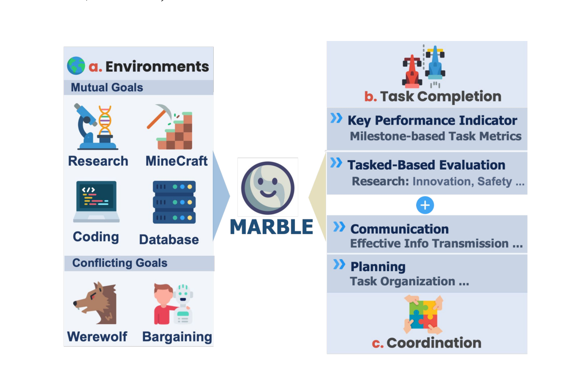
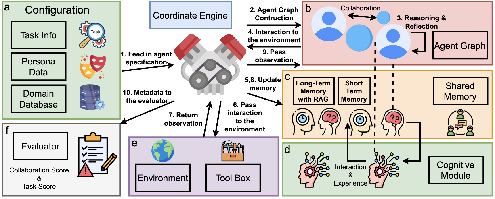

<div align= "center">
    <h1> MARBLE</h1>
</div>


**M**ulti-**A**gent Coo**R**dination **B**ackbone with **L**LM **E**ngine


**MultiAgentBench** is a modular and extensible framework designed to facilitate the development, testing, and evaluation of multi-agent systems leveraging Large Language Models (LLMs). It provides a structured environment where agents can interact within various simulated environments, utilizing cognitive abilities and communication mechanisms to perform tasks collaboratively or competitively.

<div style="display: flex; justify-content: center;">
  <div style="width: 100; transform: scale(1.0);">
    
  </div>
</div>

---

## News

- **2026-11 — Maintenance release: the benchmark runs out of the box again.**
  A fresh clone of `main` could not start the engine at all (a syntax error in the
  evaluator) and several scenarios needed undocumented manual steps. This update fixes
  the reported bugs and adds a one-command runner. Highlights:
  - **One command per scenario**: `python scripts/run_benchmark.py --scenario research --model <model>`
    fills in the benchmark configs, runs the tasks, resumes interrupted runs and prints
    the aggregated scores. See [Quick Start](#quick-start).
  - **Runs from any directory, with any LiteLLM model** (OpenAI, Gemini, OpenRouter,
    Together, ...). No more `cd marble`, hand-made `result/` folders or hard-coded paths.
  - **Engine / agents**: fixed the evaluator syntax error, the tree-mode
    "Failed to parse tasks for children" error ([#188](https://github.com/ulab-uiuc/MARBLE/issues/188)),
    the communication tool listing the wrong agents ([#241](https://github.com/ulab-uiuc/MARBLE/issues/241)),
    chain mode (missing `get_agent_profiles_linked`), duplicated children in tree mode, and
    crashes on non-JSON model replies or truncated tool calls.
  - **Evaluation**: planning / communication / milestone (KPI) scores work again in every
    coordination mode (the scoring prompts raised `KeyError`, per-agent KPIs were always
    empty), bargaining is scored for both buyer and seller, coding is judged against the
    task that was actually run, and the database scenario reports accuracy directly.
  - **Minecraft**: the missing asset files are back in `data/`
    ([#243](https://github.com/ulab-uiuc/MARBLE/issues/243), [#222](https://github.com/ulab-uiuc/MARBLE/issues/222))
    and `multiagentbench/minecraft/minecraft_main.jsonl` now really contains the 100 tasks
    (it used to contain task 0 one hundred times).
  - **Werewolf**: fixed `KeyError: 'player_dead_tonight'` when the werewolves fail to agree and
    the witch uses poison ([#244](https://github.com/ulab-uiuc/MARBLE/issues/244)); prompts and
    configs now load on Linux/macOS, and API keys can come from environment variables.
  - **Database**: the PostgreSQL image is pinned (the unpinned image broke the environment),
    `sudo` is no longer required, and containers are shut down after each task.
  - Offline test-suite (`pytest`, no API key needed) covering all of the above.

---

## Table of Contents

- [News](#news)
- [Features](#features)
- [Installation](#installation)
- [Quick Start](#quick-start)
  - [Run a benchmark scenario](#run-a-benchmark-scenario)
  - [Choosing models](#choosing-models)
  - [Scenario requirements](#scenario-requirements)
  - [Outputs and metrics](#outputs-and-metrics)
  - [Run a single config](#run-a-single-config)
  - [Werewolf](#werewolf)
- [Contributing](#contributing)
- [Citation](#citation)

---

## Features

- **Modular Design**: Easily extend or replace components like agents, environments, and LLM integrations.
- **Multi-Agent Support**: Model complex interactions between multiple agents with hierarchical or cooperative execution modes.
- **LLM Integration**: Interface with various LLM providers (OpenAI, etc.) through a unified API.
- **Shared Memory**: Implement shared memory mechanisms for agent communication and collaboration.
- **Flexible Environments**: Support for different simulated environments like web-based tasks.
- **Metrics and Evaluation**: Built-in evaluation metrics to assess agent performance on tasks.
- **Industrial Coding Standards**: High-quality, well-documented code adhering to industry best practices.
- **Docker Support**: Containerized setup for consistent deployment and easy experimentation.

<div style="display: flex; justify-content: center;">
  <div style="width: 100; transform: scale(1.0);">
    
  </div>
</div>


---


## Installation

Use a virtual environment (Python 3.9 - 3.11), e.g. with anaconda3:

```bash
conda create -n marble python=3.10
conda activate marble
curl -sSL https://install.python-poetry.org | python3
export PATH="$HOME/.local/bin:$PATH"
```

Then install MARBLE and its dependencies from the repository root:

```bash
poetry install
```

### Configure API keys

Models are called through [LiteLLM](https://docs.litellm.ai/docs/providers), so set the key of
whichever provider you use. The recommended way is a `.env` file in the repository root
(it is loaded automatically):

```bash
cp .env.template .env
```

Then fill in the keys you need in `.env` (for example `OPENAI_API_KEY`, `TOGETHERAI_API_KEY`,
`OPENROUTER_API_KEY` or `GEMINI_API_KEY`). Exporting the variables in your shell works as well.

## Quick Start

### Run a benchmark scenario

`scripts/run_benchmark.py` runs MultiAgentBench tasks end to end. It can be started from any
directory:

```bash
python scripts/run_benchmark.py --scenario research --model gpt-4o-mini --limit 3
```

That command takes the first three research tasks from `multiagentbench/research/research_main.jsonl`,
fills in the model / environment / coordination settings, runs the engine and prints a summary.
Useful options (`--help` lists all of them):

| Option | Meaning |
|--------|---------|
| `--scenario` | `research`, `bargaining`, `coding`, `database` or `minecraft` |
| `--model` | Agents' model (any LiteLLM model name) |
| `--eval_model` | Judge model for the evaluator (defaults to `--model`) |
| `--task_ids 1,2,10-20` / `--limit N` | Which tasks to run (default: all 100) |
| `--coordinate_mode` | `graph` (default), `star`, `tree` or `chain` |
| `--max_iterations` | Override the number of iterations per task |
| `--output_dir` | Where results are written (default: `results/`) |
| `--overwrite` / `--summary_only` | Re-run finished tasks / only re-aggregate existing results |

Finished tasks are skipped when you run the same command again, so an interrupted run can simply
be restarted. The per-scenario wrappers in `scripts/` do the same thing, e.g.
`MODEL=gpt-4o-mini bash scripts/research/run_simulation.sh --limit 3`.

### Choosing models

Any model supported by LiteLLM works; just pass its LiteLLM name:

```bash
# OpenAI
python scripts/run_benchmark.py --scenario bargaining --model gpt-4o-mini

# Gemini through OpenRouter (set OPENROUTER_API_KEY)
python scripts/run_benchmark.py --scenario bargaining --model openrouter/google/gemini-2.5-flash

# Gemini through Google AI Studio (set GEMINI_API_KEY)
python scripts/run_benchmark.py --scenario bargaining --model gemini/gemini-2.5-flash

# Open-source models through Together AI (set TOGETHERAI_API_KEY)
python scripts/run_benchmark.py --scenario bargaining --model together_ai/meta-llama/Llama-3.3-70B-Instruct-Turbo
```

Reasoning models (e.g. Gemini 3.x, GPT-5, o-series) spend part of the completion budget on hidden
reasoning tokens, and the small per-call budgets used by the benchmark (256-512 tokens) can then
come back empty. Raise every budget to a minimum with `MARBLE_MIN_MAX_TOKENS`:

```bash
MARBLE_MIN_MAX_TOKENS=4096 python scripts/run_benchmark.py --scenario research --model openrouter/google/gemini-3.5-flash
```

Set `MARBLE_LOG_LEVEL=INFO` (or `WARNING`) for quieter logs.

### Scenario requirements

| Scenario | Extra requirements |
|----------|--------------------|
| `research`, `bargaining`, `coding` | None |
| `database` | Docker with the compose plugin (PostgreSQL + Prometheus are started and stopped for you). See [scripts/database/readme.md](scripts/database/readme.md) |
| `minecraft` | A Minecraft Java **1.19.2** server in offline mode on `localhost:25565` (`--minecraft_host` / `--minecraft_port` to change) and Node.js for the `mineflayer` bots. The blueprint assets ship in `data/` |
| Werewolf | None; it has its own entry point, see [below](#werewolf) |

### Outputs and metrics

Everything for a run is stored under `results/<scenario>/<model>/`:

- `results.jsonl`: one JSON record per task with the full transcript of every iteration, the
  per-iteration `planning_scores` and `communication_scores` (1-5, `-1` = nothing to score),
  `total_milestones` / `agent_kpis`, `token_usage`, and the scenario's task evaluation
  (`task_evaluation`, or `code_quality` for coding).
- `summary.json`: the aggregate over all finished tasks: task score, planning / communication /
  coordination score, average milestones and token usage.
- `configs/task_<id>.yaml`: the exact configuration used for each task.
- `workspace/task_<id>/solution.py` (coding only): the program written by the agents.

### Run a single config

The engine can also be run directly on any YAML config, from any directory:

```bash
python marble/main.py --config_path marble/configs/test_config_research/profile_1.yaml

# override the models and the output file without editing the YAML
python marble/main.py --config_path marble/configs/test_config_research/profile_1.yaml \
    --llm openrouter/google/gemini-2.5-flash \
    --evaluate_llm openrouter/google/gemini-2.5-flash \
    --output_path results/demo.jsonl
```

To materialise the benchmark records as YAML files yourself, use
`multiagentbench/jsonl2yaml.py` (see `multiagentbench/runjsonl2yaml.sh`).

### Werewolf

```bash
bash scripts/werewolf/run_simulation.sh        # play a game
bash scripts/werewolf/run_evaluation.sh        # evaluate the saved checkpoints
```

Models, endpoints and API keys are configured in
`marble/configs/test_config/werewolf_config/werewolf_config.yaml`; see
[scripts/werewolf/readme.md](scripts/werewolf/readme.md).

## Contributing

#### New branch for each feature

`git checkout -b feature/feature-name` and PR to `main` branch.

#### Before committing

Run `poetry run pytest` to make sure all tests pass (the suite runs offline; tests that call the OpenAI API are skipped when `OPENAI_API_KEY` is not set) and `poetry run mypy --config-file pyproject.toml .` to check static typing. (You can also run `pre-commit run --all-files` to run all checks)

#### Check github action result

Check the github action result to make sure all tests pass. If not, fix the errors and push again.

## Citation
Please cite the following paper if you find Marble helpful!
```bibtex
@misc{zhu2025multiagentbenchevaluatingcollaborationcompetition,
      title={MultiAgentBench: Evaluating the Collaboration and Competition of LLM agents},
      author={Kunlun Zhu and Hongyi Du and Zhaochen Hong and Xiaocheng Yang and Shuyi Guo and Zhe Wang and Zhenhailong Wang and Cheng Qian and Xiangru Tang and Heng Ji and Jiaxuan You},
      year={2025},
      eprint={2503.01935},
      archivePrefix={arXiv},
      primaryClass={cs.MA},
      url={https://arxiv.org/abs/2503.01935},
}
```

<p align="center">
<a href="https://star-history.com/#ulab-uiuc/MARBLE&Date">
  <picture>
    <source media="(prefers-color-scheme: dark)" srcset="https://api.star-history.com/svg?repos=ulab-uiuc/MARBLE&type=Date&theme=dark" />
    <source media="(prefers-color-scheme: light)" srcset="https://api.star-history.com/svg?repos=ulab-uiuc/MARBLE&type=Date" />
    
  </picture>
</a>
</p>
